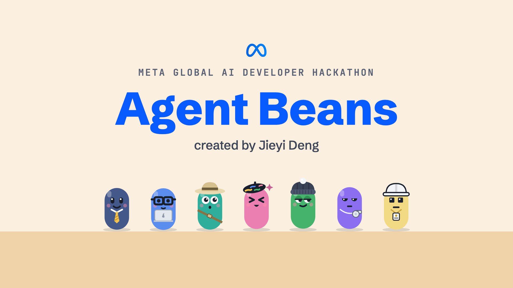
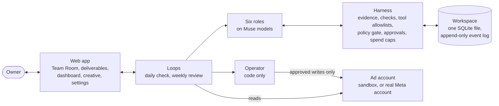

# Agent Beans



Agent Beans is an always-on AI growth team for small businesses and indie developers. The current version focuses on Meta ads.

With Agent Beans, six AI specialists review your ad account daily and plan and produce new ads each week. A seventh member, the Operator, runs as deterministic code and applies only the changes you approve. Every reported metric can be traced back to source data.

Built on Meta's Muse models for the Meta Global AI Developer Hackathon (Indie Developer Track).

**Demo video:** [Watch on YouTube](https://www.youtube.com/watch?v=QVajKCMgSk0)

**Interactive demo:** [Explore Agent Beans](https://pallas-ads.github.io/agent-beans/)

The interactive demo uses the same app interface to replay two recorded runs with live Meta models and synthetic ad accounts: Northpaw Supply, an online pet store, and Beans' Active, a new fitness app. You can explore the Team Room, deliverables, dashboard, and generated ads. Both replays are read-only.

## The problem

Running digital advertising well takes consistent attention. Someone has to review yesterday's results, spot ad fatigue, reduce wasted spend, adjust budgets carefully, and test new creative every week. Larger advertisers can hire a growth team or an agency. Many small businesses and indie developers cannot, so the owner fits this work in around everything else.

AI can help, but general advice still leaves the owner to do the work, while an agent with unchecked access to the account can put real money at risk. A useful growth team needs to do the work and earn the owner's trust: its numbers must match the data, its claims need supporting evidence, and its account changes need approval.

Agent Beans is built to close that gap: the team handles the daily and weekly work, while the owner stays in control of every change and can verify every number.

## Who it is for

- **Small businesses already running ads.** For example, an online store with a few products and some ad history. The team reviews the account every day, proposes budget changes and ads to pause within your house rules, and creates new ads using your own product photos.
- **Indie developers launching their first ad campaigns.** For example, a new fitness app with no ad history. The team plans the first tests and reviews results as they come in.
- **Owners who cannot hire a marketer or manage ads every day**, but want to stay in control of their account and budget.

## What the team does

| Role | What it does | Runs on |
| --- | --- | --- |
| Growth Lead | Plans the week, writes the test plan, assigns work | Muse Spark Open |
| Analyst | Reads the account, writes findings and test readouts, answers teammates' questions | Muse Spark Open |
| Media Buyer | Proposes budget changes and identifies ads to pause | Muse Spark Open |
| Creative Strategist | Researches the market with web search; every claim links to its source | Muse Spark 1.3 with hosted web search |
| Creative Producer | Writes ad copy and plans three scenes per ad; Producers work on separate tests in parallel | Muse Spark Open, Muse Image 1.0, SAM 3.1 |
| Reviewer | Validates deliverables and checks rendered ads against the source product photo | Deterministic checks, then Muse Spark Open with vision |
| Operator | Applies approved changes to the ad account; no other role has write access | Deterministic code |

**Every day**, the team reviews yesterday's results. Code computes every derived number and stores it as evidence with an ID. The Analyst writes findings that cite that evidence, the Reviewer checks them, and the Media Buyer proposes changes based only on reviewed findings. A policy gate checks each change against your house rules. The daily brief then arrives in the Team Room, where you can approve all of it, approve part of it, or send it back with a note.

**Every week**, the team creates new ads with two approval checkpoints. The Growth Lead writes a test plan that specifies a product and a reference photo for each test. Once you approve the plan, the Strategist researches the market, and a separate Producer writes the copy and plans three scenes for each test.

Muse Image 1.0 generates each scene using your product photo as a reference. SAM 3.1 locates the product in each generated scene so layout code can place text around it in three ad formats and assemble a 10-second video from the same images. After automated checks, the Reviewer compares each scene with your original photo and requests revisions if it finds a product mismatch. Once you approve the proposed changes, the Operator creates the new ads in a paused state. At the end of the week, each role records lessons from its results, and you can edit those lessons.

You talk to the team in the Team Room. Your notes are routed to the relevant role, and roles can ask teammates for information they need to complete a task.

## How it is built



Daily and weekly workflows drive the work. Each workflow reads the account, assigns tasks to roles, validates their responses, and publishes typed, versioned deliverables to the workspace. Each AI role is a Pydantic AI agent with its own tools and output schema. A shared harness enforces tool permissions, validation, approvals, and spending limits in code. The server uses FastAPI with a server-sent event stream, and the web app uses React with Vite. Each workspace stores the team's activity in a single SQLite file, and the Team Room provides a live view of its event log.

The same loops run against a synthetic sandbox account, used for the demo and tests, or a real Meta ad account. The team connects a real account through Facebook Login for Business, reads it through Meta's Ads MCP server, and writes to it through the Marketing API.

## Technical highlights

- **Every number is checked against evidence.** Code computes metrics and stores them as write-once evidence. Findings, readouts, answers, and ad copy must cite evidence IDs, and every quoted number must match a cited value. A wrong number is sent back before you ever see it.
- **Market claims need a real source.** The Strategist's research includes the URLs that hosted web search actually returned, and ad copy may cite only URLs from research you approved.
- **What runs is exactly what you approved.** An approval stores the content hash of the deliverable. Any later edit voids it, and the Operator refuses to act without a valid approval. Overriding a failed house rule requires the rule's name and a second confirmation.
- **Rules live in code, not in prompts.** Each role can call only its own tools, and a refused call never runs. Budget and pause changes must pass six deterministic house rules: the target exists, enough days have passed since the last budget change, the change stays within a maximum step, a campaign in its learning phase keeps its budget, an ad has spent enough before it is paused, and the total daily budget stays under a cap. A change set is evaluated together on a projected account state. Access levels (L0 observe, L1 propose, L2 apply after approval) are checked by the API and checked again by the Operator. On a real account, new ads are created paused, and the team can pause ads but can never turn them on.
- **Spend is capped before every call.** Caps are enforced per call, per role, per loop, and across the whole workspace before every paid text or image call.
- **Everything can be traced.** The event log is append-only, enforced by database triggers. Each model call's full request is stored under its hash, and `pgt inspect-call` prints back exactly what the model saw.
- **Changed facts invalidate dependent work.** Deliverables record the facts and inputs they used. When you change a fact, such as the weekly budget, dependent items are marked stale. A deterministic refresh recomputes what it can without model calls, much like a build system.
- **Memory stays grounded in evidence.** Each role keeps private memory that no other role can read. Every lesson must cite an existing source, and your edits take precedence. The feedback loop can tighten constraints but cannot relax them on its own.
- **Built for open-weight models.** Each call has a timeout and at most one retry, and failures are logged by type. Targeted repairs handle formatting errors, such as a tool call returned as plain text or raw tabs inside a JSON string, without adding content.
- **The demo uses the real app interface.** `pgt replay` exports a recorded run as a static, read-only version of the app for GitHub Pages. It accepts only synthetic sandbox data.

The [harness guide](docs/harness.md) lists 19 guarantees, each with the code that enforces it and the test that proves it.

## Built on Meta

| Meta product | Used for |
| --- | --- |
| Muse Spark Open (open weights, served through Baseten) | Powers the Growth Lead, Analyst, Media Buyer, Creative Producer, and Reviewer; the Reviewer also uses vision to inspect ads |
| Muse Spark 1.3 with hosted web search, on the Meta API | The Creative Strategist's market research, with a source URL for every claim |
| Muse Image 1.0 | Generates ad scenes using the owner's product photo as a reference; layout code adds the text |
| SAM 3.1 | Extracts the product from the original photo for the video's end card and locates it in generated scenes to keep text clear of it |
| Meta Ads MCP server | Reads from a real ad account: campaigns, ad sets, ads, insights |
| Marketing API | Executes approved account changes and supplies data the Ads MCP cannot fully retrieve |
| Facebook Login for Business | Connects an ad account with only the permissions the owner grants |

Open-weight models make an always-on team affordable. In the recorded pet-store run, 18 daily checks cost $0.62 combined, or under four cents a day. The whole run, including two weekly reviews with market research and six new ads, cost $2.02 across 204 model calls. [Meta models and products](docs/meta-models.md) breaks down the cost per role and explains why Meta's models matter here.

## Results

An offline benchmark runs the same six scenarios against Agent Beans, a single agent, an OpenAI Agents SDK team, and a LangGraph team, using three random seeds per scenario. The scenarios include an incorrect number, an unsupported claim, a prompt injection in a campaign name, an ad edited after approval, and a budget increase one day after the previous change. A simulated model injects these mistakes to test how each implementation handles them. These results measure the safeguards in the tested implementations; they do not rank model quality or the frameworks as a whole.

| Implementation | Runs passed |
| --- | --- |
| Agent Beans | 18 of 18 |
| OpenAI Agents SDK team | 12 of 18 |
| LangGraph team | 9 of 18 |
| Single agent | 3 of 18 |

Five additional experiments each remove one Agent Beans component; each fails only the scenario that component was designed to handle. See the [framework comparison](docs/HARNESS_COMPARISON.md), the [benchmark results](docs/BENCH_RESULTS.md), and the [live results](docs/LIVE_RESULTS.md).

## Run it

Requirements: Python 3.12 or later with [uv](https://docs.astral.sh/uv/), and Node 18 or later.

```bash
git clone https://github.com/Jieyi-Deng/agent-beans.git
cd agent-beans
uv sync
cd web && npm install && npm run build && cd ..
uv run pgt serve --template ecommerce
```

Open http://127.0.0.1:8000. Without `--live`, the team uses a simulated model and a synthetic ad account, with no paid API calls. Use `--template app` for the fitness app or add `--cold` to start with no ad history. The first screen asks for a display name and an optional photo; if you skip the photo, the app shows your initials. Neither is included in model prompts.

To use live Muse models with a sandbox account, copy `.env.example` to `.env`, add your API keys, and set a spending cap in US dollars:

```bash
uv run --env-file .env pgt serve --live --template ecommerce --cap 5
```

To connect a real ad account from a local installation, configure Facebook Login in your `.env` file using the settings documented in `.env.example`.

Other commands: `pgt simulate` runs daily checks over simulated days, `pgt weekly` runs one weekly review, `pgt replay` records a running team as a static site, and `pgt inspect-call` prints a stored model request.

The tests and offline benchmark require no API keys:

```bash
PYDANTIC_AI_NO_BANNER=1 uv run pytest -q
uv run python -m bench.run
```

## Repository layout

The Python package and CLI retain the name `pgt` from the project's original working title, Pallas Growth Team. The product is now called Agent Beans.

| Path | Contents |
| --- | --- |
| `src/pgt/harness/` | Event log, artifacts, facts, evidence ledger, checks, policy gate, approvals, access levels, memory, context assembly |
| `src/pgt/roles/` | One module per role |
| `src/pgt/loops/` | Daily checks, weekly reviews, end-of-week learning, and refreshes after fact changes |
| `src/pgt/llm/` | Model routing, Meta and Baseten clients, Muse Image and SAM 3.1, response repairs, and the simulated model |
| `src/pgt/sandbox/` | The synthetic ad account and the businesses the demo and tests run on |
| `src/pgt/ads/` | Real ad accounts: Ads MCP reads, Marketing API writes, Facebook Login |
| `src/pgt/creative/` | Product cutouts, ad layouts in three sizes, and the 10-second video |
| `src/pgt/api/`, `web/` | The FastAPI server and the React app |
| `bench/` | The comparison benchmark and the implementations it evaluates |
| `spike/` | The Day 1 spike that chose Pydantic AI for the per-role agent loop |
| `tests/` | Unit, API and scenario tests |

The public website and its recorded runs are maintained in a separate repository, [Pallas-ads/agent-beans](https://github.com/Pallas-ads/agent-beans). The recordings are exported with `pgt replay`.

## Documentation

| Document | What it covers |
| --- | --- |
| [Architecture](docs/architecture.md) | System overview, the team, the daily and weekly loops, the data model, real ad accounts, the public replay |
| [The harness](docs/harness.md) | Each guarantee, how it works, where it lives, and the test that proves it |
| [Meta models and products](docs/meta-models.md) | Which Meta model or product runs each part, the cost of a live run, and why Meta's models matter here |
| [Framework comparison](docs/HARNESS_COMPARISON.md) | Agent Beans against a single agent, an OpenAI Agents SDK team and a LangGraph team |
| [Benchmark results](docs/BENCH_RESULTS.md), [live results](docs/LIVE_RESULTS.md) | Full tables from the offline and live runs |

## License

The code in this repository is MIT licensed. The fonts in `src/pgt/creative/fonts/` come with their own licenses, included next to them.

**Built with Muse Spark Open.** The team's roles run on Muse Spark Open, used under the Muse Model License, which asks for this notice. The model weights are not part of this repository.
